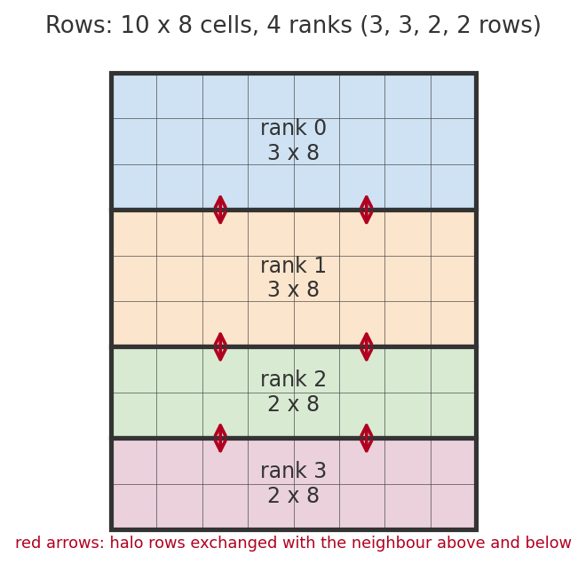
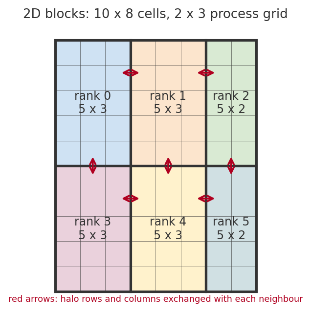

# Design notes

For exact numerical and parallel implementations are not discussed here, please refer to `experiment_plan.md`.

## Model

We aim to solve a two-dimensional advection–diffusion model of a passive scalar $c(x,y,t)$, for example pigment concentration, on the designated rectangular bound $[0,l_x] \times [0,l_y]$:

$$
\begin{align}
\frac{\partial c}{\partial t}
+ \nabla \cdot (\mathbf{u}c)
= \kappa \left(
\frac{\partial^2 c}{\partial x^2}
+ \frac{\partial^2 c}{\partial y^2}
\right)=\kappa \nabla^2c
\end{align}
$$

- $\kappa > 0$ is a constant diffusivity left to our choice and is prescribed in `defaults.json`.
- $\mathbf{u} = (u, v)$ is the velocity field. It is computed from the wind-driven flow described below. The scalar itself does not affect the flow. The velocity is simply derived from a streamfunction $\psi(x,y,t)$:

  $$
  \begin{align}
  u = \frac{\partial \psi}{\partial y},
  \qquad
  v = -\frac{\partial \psi}{\partial x}.
  \end{align}
  $$

  It is therefore exactly divergence-free, or incompressible in the sense of fluid dynamics, because the mixed derivatives cancel,

  $$
  \nabla\cdot\mathbf{u}
  = \frac{\partial u}{\partial x} + \frac{\partial v}{\partial y}
  = \frac{\partial^2 \psi}{\partial x\,\partial y} - \frac{\partial^2 \psi}{\partial y\,\partial x}
  = 0.
  $$

- Because $\nabla\cdot\mathbf{u} = 0$, the advection term can be written as $\nabla\cdot(\mathbf{u}c) = \mathbf{u}\cdot\nabla c$. The discrete scheme below keeps the flux form so that the total amount of scalar is conserved exactly. This property becomes part of our correctness check for parallel computing in terms of volume preservation through time.

ALL four walls are no-flux walls, and ALL implementations solve the same discrete problem above.

### The wind-driven flow

Instead of prescribing directly a streamfunction, we compute the flow from the physics of a wind-driven water basin and describe it by its vorticity, the local spinning rate of the fluid,

$$
\zeta = \frac{\partial v}{\partial x} - \frac{\partial u}{\partial y}.
$$

Substituting $u = \partial\psi/\partial y$ and $v = -\partial\psi/\partial x$, we have

$$
\begin{align}
\zeta = -\frac{\partial^2 \psi}{\partial x^2} - \frac{\partial^2 \psi}{\partial y^2} = -\nabla^2\psi .
\end{align}
$$

So once $\zeta$ is compuated after each iteration, we obtain $\psi$ from (3) and further the velocity from (2).

Then, the flow evolves according to the two-dimensional incompressible Navier–Stokes equations in vorticity–streamfunction formulation, subject to prescribed **wind forcing** and **viscous diffusion**.

$$
\begin{align}
\frac{\partial \zeta}{\partial t} + \mathbf{u}\cdot\nabla\zeta = F(y,t) + \nu\nabla^2\zeta
\end{align}
$$

- Here, $\mathbf{u}\cdot\nabla\zeta$ carries the vorticity with the flow, in the same way as the pigment is carried.
- $\nu\nabla^2\zeta$ is viscosity, with $\nu > 0$. We introduce this term to keep our simulation from blowing up, so $\nu = 0$ is not allowed.
- $F(y,t)$ is the wind forcing.

We use two forms of wind forcing, chosen with `--wind`. The classical double-gyre forcing (`steady`) is

$$
F(y) = F_0\,\sin\!\Big(\frac{2\pi y}{l_y}\Big).
$$

On top of it, a more complex version is the time-periodic forcing (`periodic`), allowing the wind strength oscillate with frequency $\omega = 2\pi/T_w$:

$$
F(y,t) = F_0\,\big(1 + \alpha\sin(\omega t)\big)\,\sin\!\Big(\frac{2\pi y}{l_y}\Big).
$$

With $\alpha = 0$ it reduces to the steady forcing. For $\lvert\alpha\rvert < 1$ the wind only changes its strength. For $\lvert\alpha\rvert > 1$ it reverses during part of each period, and so do the gyres.

Now, consider what this flow looks like. As we have prescribed the formulation, we need appropriate selection of parameters to create the desired gyres and possibly eddies. The wind puts vorticity into the water, and viscosity takes it out. While the flow is slow, advection is negligible ($\mathbf{u}\cdot\nabla\zeta\approx 0$, ${\partial \zeta}/{\partial t} \approx 0$) and the two balance:

$$
\nu\nabla^2\zeta \approx -F .
$$

For $F_0 > 0$, the forcing is positive in the southern half ($0 < y < l_y/2$), so the vorticity there is positive and the southern gyre turns counterclockwise. In the northern half the signs reverse, and that gyre turns clockwise. Along $y = l_y/2$ both gyres flow the same way, so they form a horizontal jet across the basin.

The same balance gives the strength of the flow. With the wavenumber of the forcing $k = 2\pi/l_y$, we have $\zeta \sim F_0/(\nu k^2)$ and $\psi \sim \zeta/k^2$, so the velocity scale is

$$
U \sim \frac{F_0}{\nu k^3},
\qquad
k = \frac{2\pi}{l_y}.
$$

The Reynolds number $\mathrm{Re} = U l_x/\nu$ compares advection with viscosity. At small $\mathrm{Re}$ the flow settles into two steady gyres. At larger $\mathrm{Re}$ the jet between them becomes unstable, meanders and sheds eddies. This is the regime with the swirls that we are after.

Finally, we choose the parameters. The default basin is $1 \times 2$ ($l_x = 1$, $l_y = 2$) with $256 \times 512$ cells, so $\Delta x = \Delta y$. We fix the velocity scale $U = 1$ and choose $\mathrm{Re}$; then

$$
\nu = \frac{U l_x}{\mathrm{Re}},
\qquad
F_0 = U\,\nu\,k^3 .
$$

> **Placeholder:** the value of $\mathrm{Re}$, and with it $\nu$ and $F_0$, is being chosen with test runs that show at which $\mathrm{Re}$ the flow becomes time dependent and which grid resolves it.

With no wind ($F_0 = 0$), the flow stays at rest and $\mathbf{u} = 0$. The model then reduces exactly to the heat equation with insulated walls and $\kappa$ as the thermal diffusivity. This simplified case provides an analytical reference.

## Grid and indexing

We use a cell-centred finite-volume grid. Each grid value is the average of $c$ over one cell, and the physical walls lie on cell faces.

- $n_x$: global cells along $x$ (columns); $n_y$: global cells along $y$ (rows).
- Step size $\Delta x = l_x/n_x$, $\Delta y = l_y/n_y$.
- Grid access uses $(i, j)$ = (row, column); top-down row ordering is used in field files.
- For global row $i=1,\dots,n_y$, the cell centre is $y = l_y-(i-\tfrac12)\Delta y$; for column $j=1,\dots,n_x$, it is $x = (j-\tfrac12)\Delta x$.
- Row $i=0$, row $i=n_y+1$, column $j=0$ and column $j=n_x+1$ are ghost cells outside the walls. The top wall is the face between rows 0 and 1, at $y = l_y$.
- The east face of cell $(i,j)$ is at $x = j\,\Delta x$. The north face of cell $(i,j)$ is at $y = l_y-(i-1)\Delta y$.

### Corner points

The flow fields $\psi$ and $\zeta$ are stored at the cell corners. The corner fields use the same `Field` structure as the pigment field, allowing us to reuse the existing grid decomposition and the halo exchange.

- Every entry $(i,j)$ holds the south-east corner of cell $(i,j)$. This corner lies at

  $$
  x = j\,\Delta x,
  \qquad
  y = l_y - i\,\Delta y .
  $$

- Corners with $1 \le i \le n_y-1$ and $1 \le j \le n_x-1$ are the unknowns. There are $(n_y-1)(n_x-1)$ of them.
- Corners on the bottom and right walls ($i = n_y$ or $j = n_x$) are stored in the last row or column of the blocks on those walls.
- Corners on the top and left walls ($i = 0$ or $j = 0$) are the ghost row and column of the blocks on those walls.

All wall corners hold 0, see "Boundary conditions".

## Velocity on faces

We store or evaluate one normal velocity $(u,v)=(\frac{\partial\psi}{\partial y},-\frac{\partial\psi}{\partial x})$ per cell face, computed from $\psi$ at the face's two end points,

on east face, we compute,
$$
U_e(i,j) = \frac{\psi\big(j\Delta x,\; l_y-(i-1)\Delta y\big) - \psi\big(j\Delta x,\; l_y-i\Delta y\big)}{\Delta y}
$$

on the north face, we compute,
$$
V_n(i,j) = -\,\frac{\psi\big(j\Delta x,\; l_y-(i-1)\Delta y\big) - \psi\big((j-1)\Delta x,\; l_y-(i-1)\Delta y\big)}{\Delta x}
$$

With this construction the discrete divergence of every cell is exactly zero. We prove this in the following.
$$
(\nabla\cdot\mathbf u)_{i,j}
\approx
\frac{U_e-U_w}{\Delta x}
+
\frac{V_n-V_s}{\Delta y}
=\frac{1}{\Delta x \Delta y}[\psi_{NE}-\psi_{SE}
$$
$$
-\psi_{NW}+\psi_{SW}-\psi_{NE}+\psi_{NW}+\psi_{SE}-\psi_{SW}]=0
$$

Here $\psi$ at the corners comes from the Poisson equation, see "Discretization". With the corner storage of "Corner points", the two formulas in implementation read

$$
U_e(i,j) = \frac{\psi_{i-1,j} - \psi_{i,j}}{\Delta y},
\qquad
V_n(i,j) = -\,\frac{\psi_{i-1,j} - \psi_{i-1,j-1}}{\Delta x}.
$$

## Discretization

We first discretize the pigment equation, then the vorticity equation and the Poisson equation for $\psi$.

### Pigment

Write the update in conservative form. For each face, compute one total flux, advective plus diffusive $F_{\text{total}}=F_{\text{advection}}+F_{\text{diffusion}}$, using first-order upwinding for advection and a central difference for diffusion:

$$
F_e(i,j) = U_e \cdot \begin{cases} c_{i,j} & U_e > 0 \\ c_{i,j+1} & \text{otherwise} \end{cases}
\;-\; \kappa\,\frac{c_{i,j+1} - c_{i,j}}{\Delta x}
$$

$$
G_n(i,j) = V_n \cdot \begin{cases} c_{i,j} & V_n > 0 \\ c_{i-1,j} & \text{otherwise} \end{cases}
\;-\; \kappa\,\frac{c_{i-1,j} - c_{i,j}}{\Delta y}
$$

$$
\begin{align*}
c^{\,n+1}_{i,j} &= c^{\,n}_{i,j}
- \frac{\Delta t}{\Delta x}\big(F_e(i,j) 
- F_e(i,j-1)\big)\\
&- \frac{\Delta t}{\Delta y}\big(G_n(i,j) - G_n(i+1,j)\big)
\end{align*}
$$

Use forward Euler in time. The flow is evaluated at the old time level $t_n$ for time-dependent flows.

$$c^{n+1}=c^n+\Delta t\,\, \mathcal{L}(c^n, t_n)$$

Here, we bring in a bit discussion about the numerical error introduced by our discretization. Upwinding is stable and non-oscillatory but adds numerical diffusion of roughly $\lvert u\rvert\Delta x/2$ in $x$ and $\lvert v\rvert\Delta y/2$ in $y$. The leading spatial error is therefore first order in $\Delta x$ and $\Delta y$. Here is a detailed breakdown of the overall introduced error from the advection computation as well as other possible sources.

As we use first-order upwinding difference for advection term, we have 

$$\frac{\partial c}{\partial x}\approx \frac{c_{i,j}-c_{i, j-1}}{\Delta x}$$

where using a Taylor expansion, 
$$
\begin{align*}
\frac{c(x)-c(x-\Delta x)}{\Delta x}
&=\frac{c(x)-(c(x)-\Delta x c_x + c_{xx}\Delta x^2/2 +O(\Delta x^3))}{\Delta x}\\
&=c_x-\frac{\Delta x}{2}c_{xx}+O(\Delta x^2)
\end{align*}
$$
The leading spatial discretization error term here is $-\frac{\Delta x}{2}c_{xx}\approx O(\Delta x)$. For our two-dimensional case, this would introduce $O(\Delta x)+O(\Delta y)$.

Now, consider the diffusion, as we employ another discretization scheme, the central difference, we have 

$$
c_{xx}\approx
\frac{c_{i,j+1}-2c_{i,j}+c_{i,j-1}}{\Delta x^2}
$$

giving an error of $O(\Delta x^2)$, and a total error term of $O(\Delta x^2)+O(\Delta y^2)$ in two dimensions. 

Finally, we have the error introduced from the time integration, giving $O(\Delta t)$. Indeed, we can reduce this amount of error by introducing a higher-order discretization scheme, however, that would require higher computational capacity and is thus left to our future study if possible. 

### Vorticity

We first move every term except the time derivative to the right-hand side:

$$
\frac{\partial \zeta}{\partial t} = R(\zeta, \psi, t) = -\mathbf{u}\cdot\nabla\zeta + F + \nu\nabla^2\zeta .
$$

To discretize the advection term, we write it in a general Jacobian form

$$
J(a, b) = \frac{\partial a}{\partial x}\frac{\partial b}{\partial y} - \frac{\partial a}{\partial y}\frac{\partial b}{\partial x}.
$$

With $u = \partial\psi/\partial y$ and $v = -\partial\psi/\partial x$, we have

$$
\mathbf{u}\cdot\nabla\zeta
= \frac{\partial \psi}{\partial y}\frac{\partial \zeta}{\partial x} - \frac{\partial \psi}{\partial x}\frac{\partial \zeta}{\partial y}
= -J(\psi, \zeta),
$$

so the right-hand side becomes

$$
R = J(\psi, \zeta) + F(y,t) + \nu\nabla^2\zeta .
$$

We discretize each term at every unknown corner. We name the eight neighbouring corners by compass direction: E, W, N, S, NE, NW, SE and SW. In storage, for example, N is the row above ($i-1$) and E is the column to the right ($j+1$).

For the advection, we use the Arakawa Jacobian. It is the average of three second-order approximations of $J$:

$$
\begin{align}
J_{++} &= \frac{(\psi_E-\psi_W)(\zeta_N-\zeta_S) - (\psi_N-\psi_S)(\zeta_E-\zeta_W)}{4\,\Delta x\,\Delta y},\\

J_{+\times} &= \frac{\psi_E(\zeta_{NE}-\zeta_{SE}) - \psi_W(\zeta_{NW}-\zeta_{SW}) - \psi_N(\zeta_{NE}-\zeta_{NW}) + \psi_S(\zeta_{SE}-\zeta_{SW})}{4\,\Delta x\,\Delta y},\\

J_{\times+} &= \frac{\zeta_N(\psi_{NE}-\psi_{NW}) - \zeta_S(\psi_{SE}-\psi_{SW}) - \zeta_E(\psi_{NE}-\psi_{SE}) + \zeta_W(\psi_{NW}-\psi_{SW})}{4\,\Delta x\,\Delta y}\\
\end{align}
$$

$$
J \approx \frac{1}{3}\big(J_{++} + J_{+\times} + J_{\times+}\big).
$$

Together, their average conserves both the energy and the enstrophy of the flow. At the spatial discretization level, this scheme avoids artifical dissipation of these quantities by the nonlinear advection operator. However, such virtue is not guaranteed for the viscosity. For the viscosity, we use the five-point Laplacian, the same operator as for the pigment diffusion:

$$
\nu\nabla^2\zeta \approx \nu\left(\frac{\zeta_E - 2\zeta + \zeta_W}{\Delta x^2} + \frac{\zeta_N - 2\zeta + \zeta_S}{\Delta y^2}\right).
$$

The forcing $F$ is evaluated at the corner's $y$ and at the old time $t_n$.

In time, we use the third-order Adams–Bashforth method (AB3). It combines the right-hand sides of the last three steps:

$$
\zeta^{n+1} = \zeta^n + \Delta t\left(\frac{23}{12}R^n - \frac{16}{12}R^{n-1} + \frac{5}{12}R^{n-2}\right).
$$

Older right-hand sides do not exist at the start, so the first step uses forward Euler and the second step uses AB2:

$$
\zeta^{2} = \zeta^{1} + \Delta t\left(\frac{3}{2}R^{1} - \frac{1}{2}R^{0}\right).
$$

We do not use forward Euler throughout, because it is unstable for the centred Arakawa advection. We also prefer AB3 to a three-stage Runge–Kutta method: AB3 evaluates $R$ once per step, so it needs one Poisson solve per step instead of three.

The vorticity is therefore second order in space and third order in time, while the pigment stays first order in both, as discussed above.

### Poisson equation for ψ

After each step, we recover $\psi^{n+1}$ from $\zeta^{n+1}$. We discretize $\nabla^2\psi = -\zeta$ with the five-point Laplacian at every unknown corner:

$$
-\left(\frac{\psi_E - 2\psi + \psi_W}{\Delta x^2} + \frac{\psi_N - 2\psi + \psi_S}{\Delta y^2}\right) = \zeta,
$$

with $\psi = 0$ at the wall corners. This is a linear system with one equation per unknown corner.

The matrix $A$ of this system is symmetric and positive definite, so we solve $A\psi = \zeta$ with the conjugate gradient (CG) method. $A$ is never stored: applying it to a field is the stencil above.

Starting from a guess $\psi_0$, CG sets $r_0 = \zeta - A\psi_0$ and $p_0 = r_0$, and then repeats for $k = 0, 1, 2, \dots$:

$$
\alpha_k = \frac{r_k\cdot r_k}{p_k\cdot A p_k},
\qquad
\psi_{k+1} = \psi_k + \alpha_k p_k,
\qquad
r_{k+1} = r_k - \alpha_k A p_k,
$$

$$
\beta_k = \frac{r_{k+1}\cdot r_{k+1}}{r_k\cdot r_k},
\qquad
p_{k+1} = r_{k+1} + \beta_k p_k .
$$

- The guess $\psi_0$ is the previous step's $\psi^n$, which is already close to the answer (a warm start).
- The iteration stops when the residual is small compared with the right-hand side,

  $$
  \lVert r_k\rVert_2 \le \text{tol}\,\lVert \zeta\rVert_2 ,
  $$

  with $\text{tol} = 10^{-10}$ by default (`--poisson-tol`). The run stops with an error if this takes more than `--poisson-max-iter` iterations.
- If $\zeta = 0$ everywhere, the solution is $\psi = 0$ and no iteration is needed.

Each iteration needs one halo exchange (for $A p_k$, which reads the four nearest neighbours) and two global sums (the dot products $p_k\cdot Ap_k$ and $r_{k+1}\cdot r_{k+1}$). The solver itself contains no MPI: the global sum and the halo exchange are passed in, so that the serial and parallel solvers share one implementation.

The cost is the price of this simplicity. The number of iterations grows with the grid: a step of the default flow needs about 180 iterations on $128 \times 256$ cells and about 350 on $256 \times 512$, and the Poisson solve takes over 99% of the run time. A preconditioner, such as multigrid, would reduce the iterations and is left for later.

The global sums add the rank contributions in a different order in parallel, so the serial and parallel solutions differ at the level of rounding and of the tolerance, not bit for bit.

Finally, the face velocities are computed from $\psi^{n+1}$ with the formulas in "Velocity on faces".

### One time step

One step from $t_n$ to $t_{n+1}$ is:

1. Update the pigment from $c^n$ to $c^{n+1}$, using the face velocities from $\psi^n$.
2. Compute $R^n$ at every unknown corner, and advance $\zeta^n$ to $\zeta^{n+1}$ with AB3.
3. Solve the Poisson equation for $\psi^{n+1}$, starting from $\psi^n$.
4. Compute the face velocities from $\psi^{n+1}$.

## Boundary conditions

Each run adopts the following rule for all four walls.

`noflux`: no scalar crosses a wall. Before each step, set every ghost cell to the value of its adjacent interior cell, $c_{\text{ghost}} = c_{\text{adjacent}}$, so $F_{wall}^{diff}=-\kappa \frac{c_i-c_g}{\Delta x}=0$. With zero wall velocity, we have $F_{wall}^{adv}=0$. Together, the total wall flux is zero.

As ghost cells on physical walls now depend on the current interior values. They must be **refilled at the start of every step**, not only at initialization. 

Note that we don't actually need to take care of the four corner ghost cells as they are not involved in any step of the computation.

For the flow, the walls are free-slip:

$$
\psi = 0
\qquad\text{and}\qquad
\zeta = 0
\qquad\text{on the walls.}
$$

- $\psi = 0$ means that no water crosses a wall. All wall-face velocities are then exactly zero, so the pigment's no-flux rule still holds.
- $\zeta = 0$ means that the wall exerts no drag on the flow along it.

Both are imposed by holding the wall corners at 0. A no-slip wall ($\partial\psi/\partial n = 0$) would need an extra boundary condition for $\zeta$ and is left for later.

## Initial conditions

Initialize interiors from cell-centre global coordinates so that a change in decomposition cannot change the initial condition.

| `case` | Initial field | Notes |
| --- | --- | --- |
| `constant` | $c_0$ everywhere | Must stay constant under the flow, even when the flow is active. |
| `cosine_decay` | $A_0\cos\!\big(\tfrac{\pi x}{l_x}\big)\cos\!\big(\tfrac{\pi y}{l_y}\big)$ | No wind, $F_0 = 0$. Analytical reference (see below). |
| `pigment_drop` | $c_0 + A_0\exp\!\Big(-\dfrac{(x-x_0)^2 + (y-y_0)^2}{2\sigma^2}\Big)$ | Default advection–diffusion case. A Gaussian-shaped pigment blob centered at $(x_0,y_0)$, with $\sigma$ controlling its width. The flow will transport and stretch this blob throughout time. |

### Analytical reference: cosine decay

With no wind ($F_0 = 0$) and no-flux walls the model is the heat equation with zero-flux walls, and

$$
c(x,y,t) = A_0\cos\!\Big(\frac{\pi x}{l_x}\Big)\cos\!\Big(\frac{\pi y}{l_y}\Big)\,
\exp\!\Big(-\kappa\pi^2\Big(\frac{1}{l_x^2}+\frac{1}{l_y^2}\Big)t\Big)
$$

is an exact solution: $\partial c/\partial x = 0$ at $x = 0, l_x$ and $\partial c/\partial y = 0$ at $y = 0, l_y$.

The cosine mode is also an exact eigenvector of the discrete scheme. At cell centres it is symmetric about every wall face, so the mirror ghost fill $c_{\text{ghost}} = c_{\text{adjacent}}$ reproduces it exactly, and the five-point Laplacian multiplies it by $-\lambda$ with

$$
\lambda = \frac{4\kappa}{\Delta x^2}\sin^2\!\Big(\frac{\pi\Delta x}{2l_x}\Big) + \frac{4\kappa}{\Delta y^2}\sin^2\!\Big(\frac{\pi\Delta y}{2l_y}\Big).
$$

After $n$ forward-Euler steps the discrete solution is therefore exactly $(1-\lambda\Delta t)^n$ times the initial field. This gives two separate checks: agreement with $(1-\lambda\Delta t)^n$ to rounding (implementation correctness), and convergence towards the continuous exponential under refinement (discretization error).

### Initial flow

The flow starts at rest, $\psi = \zeta = 0$. We first run the flow alone for a spin-up time (`--spinup`), until the gyres have formed. Then the pigment is released with one of the cases above, and the pigment update joins each step. Spin-up and the main run are timed separately.

## Time step
This part, we explain how to choose an appropriate time step. As we employ the forward Euler scheme, we must constrain the time step size for stability.
Define the advective and diffusive rates:

$$
a = \frac{u_{\max}}{\Delta x} + \frac{v_{\max}}{\Delta y}
\quad\text{($u_{\max}$, $v_{\max}$: the largest face speeds)},
\qquad
d = 2\kappa\left(\frac{1}{\Delta x^2} + \frac{1}{\Delta y^2}\right)
$$

Validate positive dimensions, positive $\kappa$, positive $\Delta t$ and

$$
\Delta t\,(a + d) \le 1
$$

This serves as a sufficient stability restriction given our schemes. For a discretely divergence-free flow this keeps every update weight non-negative in every cell, including cells next to a no-flux wall. Each new value is then a convex combination of old values, so no new maximum or minimum is created there and the scheme is stable. With $\mathbf{u} = 0$ the condition reduces to the earlier $r_x + r_y \le \tfrac12$, where $r_x = \kappa\Delta t/\Delta x^2$ and $r_y = \kappa\Delta t/\Delta y^2$.

For automatic time stepping, `cfl` in $(0,1]$ is a safety fraction:

$$
\Delta t = \frac{\mathrm{cfl}}{a + d}
$$

We can then try different time step size to investigate the stability dynamics.

Record the Péclet numbers for each run, $\mathrm{Pe} = UL/\kappa$, using a characteristic speed $U$ and length $L$ (the solvers use $U = \max(u_{\max}, v_{\max})$ and $L = \max(l_x, l_y)$), and the grid Péclet number $\mathrm{Pe}_{\text{grid}} = \max(u_{\max}\Delta x,\, v_{\max}\Delta y)/\kappa$. A large Péclet number means the transport by the advection dominates diffusion. When $\mathrm{Pe}_{\text{grid}}$ is well above 2, upwind numerical diffusion is comparable to or larger than the physical diffusion, and this means while we can keep the computation stable, it may become physically inaccurate already.

This constraint is derived in the following way. As we use first-order upwind difference scheme for advection, we have numerical diffusion of roughly $\kappa_{num}\approx \frac{|u|\Delta x}{2}$, and similarly for $y$. Then, we have $\kappa_{num}/\kappa \approx \frac{|u|\Delta x}{2\kappa}$.

Finally, we can represent the pipeline for fitting a proper time step size. Given parameters $\Delta x, \Delta y, \kappa$ and an estimated maximum speed, we can compute the rates $a, d$ defined above. As a last step, select $\Delta t=\text{cfl}/(a+d)$ and check it during the run, as described below.

### Checking the time step during the run

We cannot bound the speeds in advance, as the flow is not known before the run. We therefore keep $\Delta t$ fixed for the whole run. This also keeps the runs reproducible and the benchmarks comparable.

$\Delta t$ is either given directly (`--dt`), or derived with the rule above from `cfl` and an estimated maximum speed (`--max-speed`).

During the run, every few steps (`--check-interval`), we measure the actual largest face speeds $u_{\max}$ and $v_{\max}$. In parallel this needs one global maximum (`MPI_Allreduce` with `MPI_MAX`). The run stops with a clear message if one of three limits is exceeded:

1. The pigment limit above, $\Delta t\,(a + d) \le 1$, now with the measured speeds.
2. The vorticity advection, which must stay inside the stability region of AB3 for centred advection:

   $$
   \Delta t\left(\frac{u_{\max}}{\Delta x} + \frac{v_{\max}}{\Delta y}\right) \le 0.5 .
   $$

3. The viscosity:

   $$
   \nu\,\Delta t\left(\frac{1}{\Delta x^2} + \frac{1}{\Delta y^2}\right) \le 0.1 .
   $$

   The most negative eigenvalue of the viscous term is $-4\nu(1/\Delta x^2 + 1/\Delta y^2)$, and AB3 is stable on the negative real axis only up to $6/11$, so the limit is about $0.136$; $0.1$ keeps a margin.

The periodic wind adds no limit, because one period $T_w$ spans many thousands of steps for any reasonable $T_w$.

## Data storage and shared computation

Use contiguous `std::vector<double>` storage. Each local field includes a one-cell halo on every side, and each solver owns a current and next field. The row stride is `local_nx+2`.

For steady flows, store local face velocities: `U` has `local_ny` rows of `local_nx+1` east/west faces and `V` has `local_ny+1` rows of `local_nx` north/south faces, all computed once from global coordinates. For time-dependent flows, recompute the local face velocities at the start of each step; this cost is part of the measured solver loop. Record which approach is used, because it changes the memory traffic and arithmetic per cell.

The shared stencil computes a single destination value from the five cell values and the four face velocities of that cell. It contains no MPI calls, OpenMP regions, allocation or output. The serial and parallel solvers control the loops. This separation makes formula changes explicit and keeps the serial executable free from MPI/OpenMP dependencies.

Initialize interiors by global coordinates. Fill physical-wall ghosts by the boundary rule and process halos by exchange before their values are used in each step.

For the flow, each rank also stores the corner fields $\psi$ and $\zeta$, and the right-hand sides $R^{n-1}$ and $R^{n-2}$ needed by AB3, all with the same shape as the pigment field. The CG solver needs three more work fields of that shape: the residual $r$, the search direction $p$ and $Ap$.

## Domain decomposition

### Rows

We divide the global grid into horizontal strips, assigning each MPI process a set of consecutive rows spanning all $(n_x)$ columns. Distribute $n_y$ rows over the $p$ ranks. With $q = \lfloor n_y/p\rfloor$ and $r = n_y \bmod p$, the first $r$ logical row positions get $q+1$ rows and the rest get $q$. For a zero-based logical position ($s$), the starting global row and local row count are 

$$\mathrm{start}(s)=sq+\min(s,r),
\mathrm{count}(s)=q+(s<r).$$

We create a one-dimensional Cartesian communicator using `MPI_Cart_create`, where processes are logically arranged from top to bottom. We use `MPI_Cart_shift` to identify its upper and lower neighbors. We switch rank reordering off (`reorder = 0` in `MPI_Cart_create`), so every rank keeps the number it has in `MPI_COMM_WORLD` and MPI cannot move a rank away from the core the launcher chose for it. This keeps the placement the same in all runs that we compare.

Before evaluating a stencil that requires neighboring rows, each process exchanges its first and last interior rows with its upper and lower neighbors, respectively. 

*Row decomposition of a $10 \times 8$ grid over $p = 4$ ranks: here $q = 2$, $r = 2$, so the first two ranks get 3 rows and the others 2. Each rank exchanges halo rows with the rank above and below.*

### Two-dimensional blocks
We divide the global ($n_y\times n_x$) grid into rectangular blocks using a two-dimensional Cartesian process grid of size ($p_y\times p_x$), where ($p_yp_x=p$).

Each MPI process is assigned a logical coordinate $(s_y,s_x)$, with $0\le s_y<p_y$ and $0\le s_x<p_x$. Rows and columns are distributed independently, including any remainders.

For each dimension ($d\in{x,y}$), define

$$
q_d=\left\lfloor\frac{n_d}{p_d}\right\rfloor,\qquad r_d=n_d\bmod p_d.
$$

*Two-dimensional decomposition of a $10 \times 8$ grid on a $2 \times 3$ process grid: the 8 columns split as 3, 3, 2. Interior ranks have up to four neighbours, and ranks on the global edge have walls on the other sides.*

The neighbours come from an MPI Cartesian communicator:

- We create it with `MPI_Cart_create` as a non-periodic $p_y \times p_x$ grid, with rank reordering switched off as for the rows. All later communication uses this communicator.
- `MPI_Cart_shift` gives the north, south, west and east neighbours. On the global edge it returns `MPI_PROC_NULL`, so a rank has a physical wall exactly on those sides and no message is sent there.

Rows are contiguous in row-major storage, so a halo row is sent straight from the field with an MPI vector datatype. Columns are not contiguous: we copy them into a send buffer (column packing), send the buffer, and copy the received buffer into the ghost columns. The blocking and the overlapping exchange use the same packing, so comparing them changes only when the messages are sent and waited for.

## Halo exchange

Upwinding and the five-point diffusion term use only the four nearest neighbours, so a one-cell halo is sufficient.

The blocking baseline can use `MPI_Sendrecv` with consistent partners and tags. It must not rely on eager buffering to avoid deadlock. Sides on a physical wall have no rank neighbour; fill those ghosts by the boundary rule instead.

For overlap:

1. Post receives into the current field's halos.
2. Post sends from its owned edge values or dedicated send buffers.
3. Fill physical-wall ghosts from the current owned values; this is local work.
4. Update points that do not depend on incoming halos.
5. Complete all sends and receives.
6. Update the remaining owned points exactly once.
7. Swap current and next buffers.

Do not modify send buffers, read incomplete receive buffers or reuse communication resources before the matching requests complete. Small local blocks may have no strict interior; handle them without duplicate edge updates.

Nonblocking calls do not guarantee a performance improvement. MPI progress, message size and available independent work determine whether overlap helps.

### Corner fields

The Arakawa Jacobian reads diagonal neighbours, so $\psi$ and $\zeta$ also need their corner ghost cells. We get them by exchanging in two phases: first the columns, then the rows including their ghost columns. The row message then carries the values that the sender has just received from its east and west neighbours, which are the receiver's diagonal neighbours.

The two phases must run in order, so this exchange is blocking. The pigment update and the CG iterations only read the four nearest neighbours and use the ordinary exchange; for the pigment it can be blocking or overlapping.

## OpenMP and MPI thread support

We start with `MPI_Init_thread(..., MPI_THREAD_FUNNELED, ...)` and verify that the library provides this level. Only the initializing thread performs MPI calls. OpenMP worksharing distributes destination grid points among threads. Each thread computes the face fluxes it needs for its own destination cells; do not write shared face-flux arrays from several threads. Complete the worksharing region before the master thread swaps buffers or starts dependent work.

Builds without OpenMP are supported by guarding OpenMP-specific calls with the build definition. We do not add global per-step barriers without a demonstrated need; halo completion and local worksharing already enforce their own dependencies.

### Threads per rank

The number of threads per rank is chosen in this order:

1. the option `--threads N`, if given;
2. otherwise the environment variable `OMP_NUM_THREADS`;
3. otherwise one thread, so that a forgotten variable cannot oversubscribe the cores.

We switch off the dynamic adjustment of the thread count, so that the number of threads is the one that was asked for, and we check that all ranks use the same number, because timings with different thread counts per rank would not be comparable. The run records the number of threads actually in use. A build without OpenMP rejects `--threads N` with $N > 1$.

### MPI errors

We set `MPI_ERRORS_RETURN` on `MPI_COMM_WORLD` and on the Cartesian communicator, and check the return code of every MPI call. A failing call becomes an exception that names the call and the MPI error. The exception ends in `main`, which prints the rank and calls `MPI_Abort`. This also stops runs with invalid arguments. Without the abort, the other ranks would wait forever in a collective call for the rank that has failed. A failure of the file output on rank 0 alone, which would leave the other ranks waiting, aborts the job on the spot.

### Nodes

The same number of ranks performs differently on one node and on several. We count the nodes of a run as the number of groups of ranks that can share memory (`MPI_Comm_split_type` with `MPI_COMM_TYPE_SHARED`), and record this number together with the ranks and the threads.

## Diagnostics

Total scalar over interior cells:

$$
M = \Delta x\,\Delta y \sum_{i,j} c_{i,j}.
$$

With `noflux` walls $M$ is conserved up to rounding. In the parallel solver $M$ needs an `MPI_Allreduce`; compute it only at snapshot intervals or after the timed loop, and compare serial and parallel values with a tolerance because the summation order differs.

For the flow, we also record the kinetic energy $E$ and the enstrophy $Z$:

$$
E = \frac12\,\Delta x\,\Delta y\sum_{\text{corners}} \psi\,\zeta,
\qquad
Z = \frac12\,\Delta x\,\Delta y\sum_{\text{corners}} \zeta^2 .
$$

$E$ is the kinetic energy $\frac12\int \lvert\mathbf{u}\rvert^2$, because $\zeta = -\nabla^2\psi$ and $\psi = 0$ on the walls, so integrating by parts gives $\int \psi\zeta = \int \lvert\nabla\psi\rvert^2$. Both sums need a global sum in parallel. We also record the time spent in the Poisson solve and the number of CG iterations per step.

## Output and metrics

Small validation runs may gather the global matrix. Gathering and file writing happen outside solver-loop timing. Global output contains the $n_y \times n_x$ interior cells once, never ghost cells or duplicate process halos. Record the parameters ($\kappa$, $\nu$ and the wind parameters), the mass error and the number of ranks, threads per rank and nodes actually used in the run metadata.

Time the whole loop, including necessary communication, wall-ghost filling and any per-step velocity evaluation. Synchronize before the timed MPI region and report the maximum elapsed time over ranks. Keep initialization, validation and output timings separate. Phase timings under overlap are diagnostic and must not be blindly added together.

Snapshots also store $\psi$ and $\zeta$, so that the plots can draw the streamlines and the vorticity of the flow.

## Scope

The project uses CPUs, a five-point stencil with first-order upwind advection, constant diffusivity and rectangular geometry. The velocity field is computed from the two-dimensional Navier–Stokes equations in vorticity form (see "Model"). Higher-order pigment advection with wider halos, bottom friction, no-slip walls, irregular coastlines, variable materials, implicit methods, CUDA and a web interface are outside the current plan.

## Follow-up

The flow is implemented in the serial and the parallel solver, with the checks of `experiment_plan.md`. Still open:

- The parameters of the wind-driven flow (the placeholder in "Model").
- `report/report.md` (sections 1 and 4) still describes the old heat-only model and needs a matching update.
